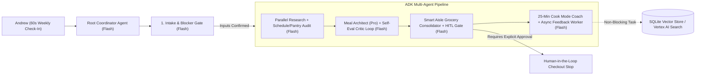

# Andrew's Family Meal & Wellness Command Center (`L200CapstoneAgent`)

A **Personal Concierge Multi-Agent System** built with the **Google Agent Development Kit (`google-adk`)** that automates and expedites the entire weekly family meal lifecycle — **from a 60-second Sunday check-in through recipe research, schedule-aligned meal planning, aisle-sorted grocery shopping, and 25-minute weeknight cooking** — so Andrew can protect his health routines and maximize evening core-memory time with his spouse and two young children.

---

## 1. Problem & Objective

Andrew is a busy working professional balancing a spouse, two young children with strict daily routines, personal fitness, and a full workday:

- **05:00 – 06:00 AM CST**: Daily morning workout.
- **06:00 – 06:45 AM CST**: Post-workout recovery fuel ($\ge 30\text{g}$ protein) + preparing family breakfast in $\le 10$ minutes.
- **08:00 AM – 05:00 PM CST**: Daily work block (requires zero-friction grab-and-go lunches).
- **05:00 – 08:00 PM CST**: Family dinner ($\le 25\text{ minutes}$ active cooking) + evening core memories and bedtime routines with his children and spouse.

Traditional meal planning, grocery list deduplication, and weeknight recipe hunting consume hours of scarce family bandwidth. **This Command Center Agent eliminates that friction** while surfacing any required weekly inputs from Andrew *before* orchestrating the week.

---

## 2. Key Macro Functional Elements



1. **Pre-Planning Weekly Intake Gate (`intake_readiness_agent`)**: Surfaces the 4 high-signal weekly inputs needed from Andrew (busy/late post-5PM nights, Sunday batch-prep window, fridge items/kid cravings, and weekly budget ceiling) *before* generating a plan.
2. **Multi-Agent Orchestration (`Coordinator` + `ParallelAgent` + `LoopAgent` + `SequentialAgent`)**:
   - **Parallel Research & Pantry Audit**: Concurrently queries nut-safe, high-protein, kid-friendly recipes and audits Andrew's schedule + pantry stock.
   - **Pro-Tier Meal Architect + Self-Eval Loop**: Uses `gemini-2.5-pro` to synthesize 21 weekly meals + a 75-minute Sunday batch-prep gameplan, verified by `SelfEvalGuardrail` (`gemini-2.5-flash`) for $\le 30\text{m}$ weeknight cook times, $\ge 28\text{g}$ post-workout breakfast protein, kid split-seasoning tips, zero allergens, and budget compliance.
   - **Smart Aisle Grocery Consolidator**: Deduplicates ingredients across all 7 days, subtracts stocked pantry items, and groups items by store aisle.
   - **Zero-Stress 25-Minute Cook Mode**: Produces parallelized `T+0m` to table step cards with kid-portion split checkpoints.
3. **Human-in-the-Loop (HITL) Safety Gates (`HumanApprovalGate` + `FunctionTool(require_confirmation=True)`)**: Hard-stops execution with `PENDING_HUMAN_APPROVAL` before submitting paid grocery orders or writing shared calendar blocks until Andrew explicitly approves.
4. **Persistent Session & Async Vector Memory (`DatabaseSessionService` + `FamilyPersistentMemoryStore` + `AsyncMemoryConsolidationWorker`)**: Stores conversational history, pantry inventory, and semantic vector embeddings in SQLite (with Vertex AI Search / Memory Bank adapters for cloud mode), running post-meal preference consolidation asynchronously in background tasks so the UI never blocks.
5. **Production AgentOps Observability & Security**:
   - **Strategic Model Routing** (`gemini-2.5-flash` for low-latency lookups/sorting; `gemini-2.5-pro` for multi-constraint weekly optimization).
   - **OpenTelemetry Distributed Tracing** linking parent-child spans from query to answer.
   - **Structured JSON Logging** with paired **`INTENT` vs. `OUTCOME`** audit correlation.
   - **Active PII Redaction** (`PIIRedactionPipeline` + Google Cloud DLP adapter) scrubbing emails, phone numbers, home addresses, payment cards, and child identifiers before logging or storage.
   - **Google Cloud Secret Manager** (`SecretManagerProvider`) with zero hardcoded credentials.

---

## 3. Isolation & Placeholder Configuration

By design, this repository is **100% isolated** and connects to **zero internal documents or live personal accounts**. External integrations use clean `{{PLACEHOLDER_*}}` tokens in `.env.example` and `concierge_agent/config/settings.py` ready to be substituted later:

| Placeholder Variable | Purpose When Connected |
| :--- | :--- |
| `{{PLACEHOLDER_GCP_PROJECT_ID}}` | Google Cloud project for Vertex AI, Secret Manager, DLP, & Cloud Trace |
| `{{PLACEHOLDER_VERTEX_SEARCH_DATASTORE_ID}}` | Vertex AI Search datastore for cloud recipe & memory RAG |
| `{{PLACEHOLDER_AGENT_ENGINE_ID}}` | Vertex AI Agent Engine ID for managed `VertexAiMemoryBankService` |
| `{{PLACEHOLDER_GROCERY_API_SECRET_ID}}` | Secret Manager secret ID holding external grocery delivery credentials |
| `{{PLACEHOLDER_CALENDAR_OAUTH_SECRET_ID}}` | Secret Manager secret ID for optional family calendar block sync |
| `{{PLACEHOLDER_FAMILY_CALENDAR_ID}}` | Target calendar identifier for Sunday batch-prep holds |

---

## 4. Quickstart: Running Locally & With Google ADK CLI (`adk`)

### Option A: Launch the Simplified Family Meal Command Center UI
Runs immediately in isolated mode (even before configuring cloud credentials):

```bash
git clone https://github.com/andrewjison-dev/L200CapstoneAgent.git
cd L200CapstoneAgent
python3 -m concierge_agent.ui.server --port 8080
# Open http://localhost:8080
```

### Option B: Run with the Google Agent Development Kit (`adk`) CLI

```bash
# 1. Create virtual environment and install dependencies
python3 -m venv .venv
source .venv/bin/activate
pip install -r requirements.txt

# 2. Configure environment (copy placeholders)
cp .env.example .env

# 3. Launch the interactive ADK Developer Web UI
adk web .

# 4. Run an interactive terminal session with the Coordinator Agent
adk run concierge_agent

# 5. Run the ADK CLI evaluation suite against the EvalSet
adk eval concierge_agent evals/concierge_eval.evalset.json

# 6. Deploy to Google Cloud Run or Vertex AI Agent Engine via ADK CLI
adk deploy cloud_run \
  --project=$GOOGLE_CLOUD_PROJECT \
  --region=us-central1 \
  --service_name=andrew-family-concierge-agent \
  concierge_agent

adk deploy agent_engine \
  --project=$GOOGLE_CLOUD_PROJECT \
  --region=us-central1 \
  concierge_agent
```

---

## 5. Testing, Golden-Dataset Evaluation & Terraform IaC

```bash
# Run full unit, schema, HITL, observability, PII, and secret-isolation test suite
pytest -v
# (or zero-dependency stdlib runner):
python3 -m unittest discover -s tests -v

# Run automated Golden-Dataset Regression Harness (8 end-to-end scenarios, 100% gate)
python3 -m evals.run_evaluation

# Provision cloud infrastructure via Terraform IaC
cd terraform
terraform init
terraform plan -var="project_id=your-gcp-project-id"
```

---

## 6. AgentOps Rubric Alignment Summary

| Category | Implemented Modules |
| :--- | :--- |
| **1. Tool & Interface Design** | `concierge_agent/tools/*.py` (10 descriptive tools, full Google-style docstrings, guided recovery envelopes) + `concierge_agent/schemas/models.py` (strict `extra="forbid"` JSON schemas) |
| **2. Context & Memory** | `concierge_agent/prompts/constitution.py`, `concierge_agent/memory/compaction.py` (`EventsCompactionConfig` + `ContextCacheConfig` + sliding-window summarizer), `persistent_store.py` (SQLite vector store + `DatabaseSessionService` + Vertex AI Search), `async_memory_worker.py` (`asyncio` background consolidation) |
| **3. Orchestration & Logic** | `concierge_agent/agent.py` (`Coordinator` + `SequentialAgent` + `ParallelAgent` + `LoopAgent`), `model_router.py` (`gemini-2.5-flash` vs `gemini-2.5-pro`), `guardrails_plugin.py` (`BasePlugin` + prompt-injection shield + `SelfEvalGuardrail`), `hitl_hooks.py` (`HumanApprovalGate` + `require_confirmation=True`) |
| **4. Observability & Tracing** | `concierge_agent/observability/structured_logger.py` (Cloud JSON logs + `INTENT`/`OUTCOME` pairs), `tracing.py` (OpenTelemetry linked spans), `pii_redactor.py` (Cloud DLP + regex PII scrubber) |
| **5. Infrastructure & CI/CD** | `evals/run_evaluation.py` + `golden_dataset.json` + `concierge_eval.evalset.json`, `terraform/*.tf`, `.github/workflows/ci_and_eval.yml`, `concierge_agent/config/secrets.py` (`SecretManagerServiceClient`) |
